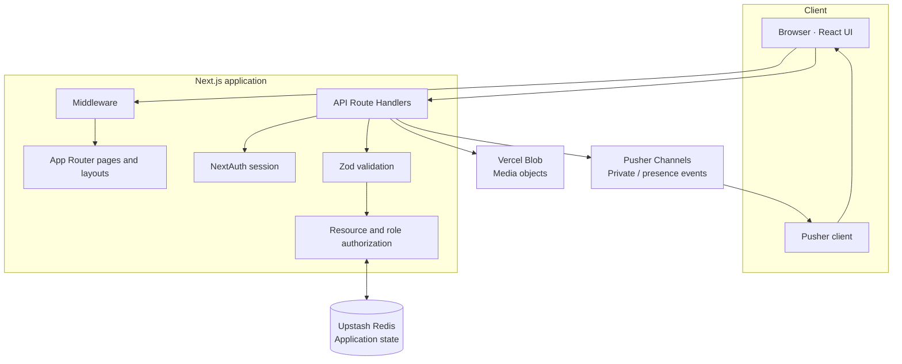
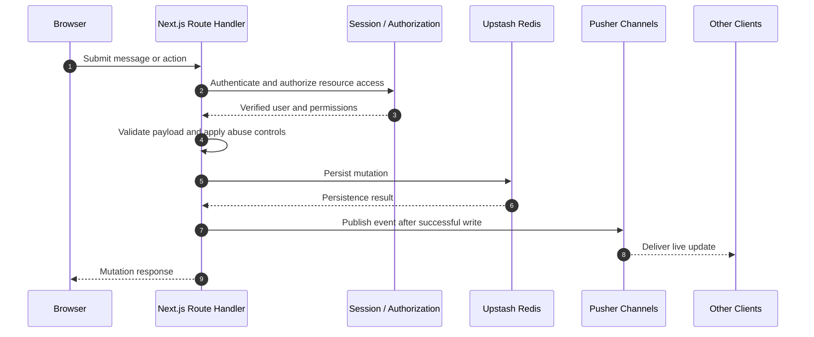

# Chat+ — Real-time Messaging & Community Platform

<p align="center">
  <strong>Conversations that scale from one-to-one chats to organized communities.</strong>
  <br />
  A full-stack messaging application built with Next.js, React, TypeScript, Redis and Pusher Channels.
</p>

<p align="center">
  <a href="https://github.com/soumya100/chatplus"></a>
  
  
  
  
  
  
</p>

---

## Contents

- [Overview](#overview)
- [Product capabilities](#product-capabilities)
- [Technology stack](#technology-stack)
- [Architecture](#architecture)
- [Repository layout](#repository-layout)
- [Getting started](#getting-started)
- [Configuration reference](#configuration-reference)
- [Development and quality checks](#development-and-quality-checks)
- [Deployment](#deployment)
- [Security and operational guidance](#security-and-operational-guidance)
- [Documentation](#documentation)
- [Contributing](#contributing)
- [License](#license)

## Overview

**Chat+** is a responsive, real-time communication platform that brings direct messaging, group collaboration and community organization into one application. It combines a Next.js App Router frontend and API layer with Redis-backed application state, Pusher-powered live updates and object storage for shared media.

The application is designed around a clear separation of responsibilities:

- **Application state** is persisted in Upstash Redis.
- **Live delivery** is handled by Pusher Channels; events notify connected clients but are not the source of truth for message history.
- **Authentication and authorization** are enforced at the server boundary.
- **Media assets** are stored through Vercel Blob rather than being embedded in message records.

> This repository is an actively developed application. The architecture and feature set documented here describe the checked-in implementation; they should not be interpreted as an independent security certification, SLA, or claim of production readiness for every deployment.

## Product capabilities

### Messaging

- One-to-one conversations and friend-request workflows.
- Group conversations with membership and administrator controls.
- Cursor-based message history and bounded pagination.
- Message replies, editing, soft deletion and emoji reactions.
- Read/unread state, typing indicators and online presence.
- Live synchronization across connected clients.

### Groups and communities

- Group roles, member management and moderation settings.
- Group details, announcements and pinned-message workflows.
- Poll creation and voting.
- Event creation and attendance responses.
- Communities for organizing related groups and members.
- Community and group-level administration with server-side permission checks.

### Media and experience

- Image, video, audio and document attachments.
- Attachment storage through Vercel Blob.
- Responsive layouts for desktop and mobile.
- Light and dark appearance modes.
- Conversation and message search.

## Technology stack

| Layer | Technologies | Responsibility |
| --- | --- | --- |
| Web application | Next.js 15 App Router, React 18, TypeScript | Pages, layouts, rendering and routing |
| API | Next.js Route Handlers | Authenticated application operations |
| Authentication | NextAuth.js, bcryptjs, optional Google OAuth | Sign-in, session handling and password hashing |
| Data and indexes | Upstash Redis | Users, conversations, groups, communities, messages and indexes |
| Real-time transport | Pusher Channels | Private/presence channels and live client updates |
| Object storage | Vercel Blob | Uploaded media and attachments |
| Validation | Zod, React Hook Form | Request and form validation |
| UI | Tailwind CSS, Headless UI, Lucide React | Responsive components and interaction patterns |
| Quality | TypeScript, ESLint, Node.js test runner | Static checks and regression coverage |

## Architecture

### System context

The browser communicates with the Next.js application for page delivery and authenticated mutations. Route handlers validate the request, resolve the session, authorize access to the target resource, persist changes, and publish real-time events where required.



### Message mutation lifecycle

Redis is the authoritative store for application state. A successful mutation should be persisted before a corresponding Pusher event is emitted.



### Architectural principles

1. **Persist before publish.** A real-time event must not make an unpersisted mutation appear authoritative.
2. **Authorize every resource operation.** A valid session alone does not grant access to arbitrary conversations, groups, communities or files.
3. **Validate at the boundary.** Treat all browser-provided values as untrusted and enforce bounded schemas on the server.
4. **Bound expensive reads.** Use cursor-based pagination and explicit limits rather than loading unbounded message histories.
5. **Protect multi-key invariants.** Use atomic Redis operations where a feature requires related records to change together.
6. **Keep secrets server-side.** Only explicitly public configuration, such as the Pusher public key and cluster, belongs in client-visible variables.

## Repository layout

```text
.
├── docs/
│   └── wiki/                 # Product, architecture, API and operations wiki
├── scripts/                  # Smoke, staging and dependency-audit scripts
├── src/
│   ├── app/                  # App Router pages, layouts and API handlers
│   ├── common/               # Shared UI primitives
│   ├── components/           # Feature-oriented React components
│   ├── helpers/              # Data and Redis helper functions
│   ├── hooks/                # Reusable React hooks
│   ├── images/               # Local image assets
│   ├── lib/                  # Auth, Redis, Pusher, validation and utilities
│   ├── types/                # Application and library type extensions
│   ├── instrumentation.ts    # Server instrumentation
│   └── middleware.ts         # Request middleware
├── tests/                    # Unit, regression, security and integration tests
├── .env.example              # Environment variable template
├── next.config.mjs           # Next.js and response-header configuration
├── package.json              # Scripts and dependencies
└── SECURITY.md               # Vulnerability reporting and security policy
```

The [project wiki](docs/wiki/README.md) contains the detailed route map, data model notes and operational workflows. For exact request/response contracts, use the current route-handler schemas as the source of truth.

## Getting started

### Prerequisites

- Node.js **20 or newer** (declared in `package.json`).
- npm or Yarn.
- An [Upstash Redis](https://console.upstash.com/) database with REST API access.
- A [Pusher Channels](https://dashboard.pusher.com/) application.
- A [Vercel Blob](https://vercel.com/docs/storage/vercel-blob) store if attachment uploads are enabled.
- Google OAuth credentials if Google sign-in is required.

### 1. Clone the repository

```bash
git clone https://github.com/soumya100/chatplus.git
cd chatplus
```

### 2. Install dependencies

Choose the package manager you use:

```bash
npm install
```

Or, with Yarn:

```bash
yarn install
```

### 3. Configure local environment

Copy the template:

```bash
cp .env.example .env.local
```

On Windows PowerShell:

```powershell
Copy-Item .env.example .env.local
```

Fill in the values described in [Configuration reference](#configuration-reference). Generate a unique secret for local use:

```bash
openssl rand -base64 32
```

Never commit `.env.local`, production credentials, session tokens or real user data.

### 4. Start the development server

```bash
npm run dev
```

Open [http://localhost:3000](http://localhost:3000).

## Configuration reference

The checked-in [`.env.example`](.env.example) is the canonical list of integration variables. Keep it in sync when adding or renaming configuration.

| Variable | Required | Exposure | Description |
| --- | --- | --- | --- |
| `NEXTAUTH_SECRET` | Yes | Server only | Strong, unique secret for NextAuth session/JWT protection. |
| `NEXTAUTH_URL` | Yes | Server only | Canonical application URL for the environment. |
| `GOOGLE_CLIENT_ID` | Optional | Server configuration | Google OAuth client ID. Configure with the matching secret to enable Google sign-in. |
| `GOOGLE_CLIENT_SECRET` | Optional | Server only | Google OAuth client secret. |
| `UPSTASH_REDIS_REST_URL` | Yes | Server only | Upstash Redis REST endpoint. |
| `UPSTASH_REDIS_REST_TOKEN` | Yes | Server only | Upstash Redis REST credential. |
| `BLOB_READ_WRITE_TOKEN` | For uploads | Server only | Vercel Blob read/write token. |
| `PUSHER_APP_ID` | Yes | Server only | Pusher application identifier. |
| `PUSHER_APP_SECRET` | Yes | Server only | Pusher server-side secret. |
| `PUSHER_APP_CLUSTER` | Yes | Server only | Pusher cluster for server SDK operations. |
| `NEXT_PUBLIC_PUSHER_APP_KEY` | Yes | Client visible | Public Pusher key used by the browser client. |
| `NEXT_PUBLIC_PUSHER_APP_CLUSTER` | Yes | Client visible | Pusher cluster used by the browser client. |
| `CRON_SECRET` | For scheduled cleanup | Server only | Bearer secret used to authenticate the scheduled cleanup/health endpoints. |

### OAuth callback configuration

When Google OAuth is enabled, register the appropriate callback URL in Google Cloud Console:

- Local: `http://localhost:3000/api/auth/callback/google`
- Production: `https://YOUR_DOMAIN/api/auth/callback/google`

Use the exact domain configured for the deployment. Do not use production OAuth credentials in untrusted preview environments.

## Development and quality checks

The following scripts are defined in `package.json`:

| Command | Purpose |
| --- | --- |
| `npm run dev` | Start the local development server. |
| `npm run build` | Create a production build. |
| `npm run start` | Serve the production build. |
| `npm run lint` | Run the configured Next.js lint command. |
| `npm run typecheck` | Run TypeScript without emitting files. |
| `npm test` | Run the Node.js test suite matched by the package script. |
| `npm run test:security` | Run security and source regression tests. |
| `npm run test:events` | Run group event/poll API and UI tests. |
| `npm run test:smoke` | Run application smoke checks. |
| `npm run test:browser` | Run browser smoke checks. |
| `npm run test:coverage` | Run tests with Node.js coverage reporting. |
| `npm run audit:security` | Run the repository dependency audit script. |
| `npm run test:staging` | Run staging validation. |

### Redis integration tests

The Redis integration script is intentionally guarded because it runs `FLUSHDB`. Use only a disposable, isolated Redis instance:

```bash
REDIS_HOST=127.0.0.1 REDIS_INTEGRATION_ALLOW_FLUSHDB=1 npm run test:redis
```

Never point destructive integration tests at production or shared data.

## Deployment

The application can be deployed to a Next.js-compatible hosting environment. The repository includes Vercel configuration; Vercel is the documented deployment path.

### Vercel deployment checklist

1. Import this GitHub repository into Vercel.
2. Confirm the project root and build settings match the repository layout.
3. Configure all required environment variables for the target environment.
4. Provision Upstash Redis, Pusher Channels and Vercel Blob, then add their credentials.
5. Set `NEXTAUTH_URL` to the canonical HTTPS production URL.
6. Add the production Google OAuth callback URL if Google sign-in is enabled.
7. Configure the scheduled cleanup job and matching `CRON_SECRET` where the deployment uses the cleanup endpoint.
8. Run the build and the relevant regression/security checks before promoting a release.
9. Verify sign-in, direct messages, group permissions, real-time updates and attachment upload/download in the deployed environment.

### Environment separation

Maintain separate credentials and service resources for development, preview and production wherever possible. Preview deployments should not inherit production secrets unless there is a deliberate, access-controlled reason to do so.

## Security and operational guidance

Security is a deployment responsibility as well as an application concern. Review [SECURITY.md](SECURITY.md) before exposing an instance to users.

- Use HTTPS and strong, unique secrets in production.
- Keep Redis, Pusher secret and Blob credentials out of client bundles and source control.
- Restrict access to hosting dashboards, logs, storage and backups.
- Rotate any credential that may have been exposed.
- Keep dependencies and the Node.js runtime updated.
- Verify authorization on the server for every conversation, group, community and attachment operation.
- Avoid logging access tokens, session cookies, message contents or unnecessary personal data.
- Use isolated test resources for integration tests and destructive maintenance jobs.
- Monitor deployment health, error rates, scheduled jobs, storage usage and third-party service quotas.

The presence of security headers, validation and automated tests does not by itself establish compliance, penetration-test status or a production SLA. Operators should perform their own threat modelling, security testing, backup/restore validation and capacity planning.

## Documentation

The repository includes a multi-page engineering wiki:

| Guide | Coverage |
| --- | --- |
| [Product overview](docs/wiki/01-product-overview.md) | Product scope, capabilities and roles |
| [Getting started](docs/wiki/02-getting-started.md) | Local setup and environment variables |
| [Architecture](docs/wiki/03-architecture.md) | Request lifecycle, Redis data and design principles |
| [Authentication and security](docs/wiki/04-authentication-security.md) | Sessions, authorization and security boundaries |
| [Messaging, groups and communities](docs/wiki/05-messaging-and-groups.md) | Group workflows, communities, polls and events |
| [Real-time events](docs/wiki/06-realtime-events.md) | Pusher channels and event delivery |
| [Media and message lifecycle](docs/wiki/07-media-and-message-lifecycle.md) | Uploads, attachments and message state |
| [API reference](docs/wiki/08-api-reference.md) | API route inventory and contracts |
| [Operations and troubleshooting](docs/wiki/09-operations-troubleshooting.md) | Deployment, diagnostics and maintenance |

## Contributing

Contributions are welcome. Before opening a pull request:

1. Create a focused branch from the latest `main`.
2. Keep changes scoped and include regression coverage for behavior changes.
3. Update the relevant wiki page when routes, configuration, permissions or workflows change.
4. Run the applicable type, lint, test and build checks.
5. Never include secrets, customer data or environment-specific credentials.
6. Describe behavior changes, test evidence and any operational impact in the pull request.

For security-sensitive findings, follow the private reporting process in [SECURITY.md](SECURITY.md) rather than opening a public issue.

## License

Distributed under the [MIT License](LICENSE).
