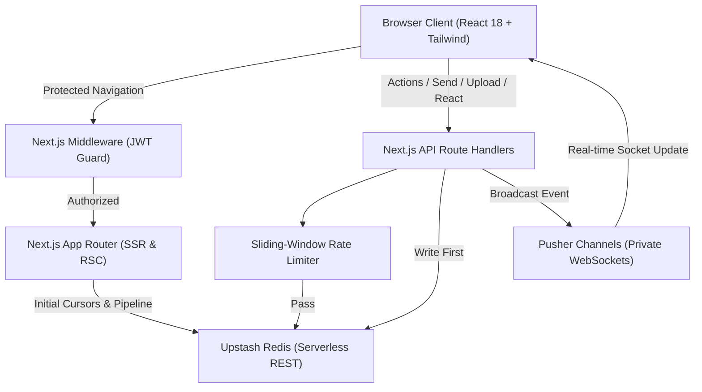

# NextChat (Chat+) – Modern Real-Time Messaging Platform


NextChat (Chat+) is a production-grade, real-time messaging application built on **Next.js 14 (App Router)**, **TypeScript**, **NextAuth.js**, **Upstash Redis**, and **Pusher Channels**. Engineered for high performance, responsiveness, and security, it delivers a smooth, low-latency communication experience across all devices.

---

## Key Features

### Core Messaging Experience
- **1-on-1 Real-Time Chat**: Sub-100ms instant message delivery powered by authenticated Pusher WebSockets.
- **Message Editing & Soft Deletion**: Edit sent messages with an inline editor and `(edited)` indicator, or soft-delete with immediate cross-client synchronization.
- **Emoji Reactions**: React with quick emojis (`👍`, `❤️`, `😂`, `😮`, `🔥`), aggregated into live interactive count badges.
- **Live Typing Indicators**: Visual typing status in the chat header and animated typing bubbles that auto-expire on inactivity.
- **Online / Offline Presence**: Live presence indicators powered by Pusher Presence channels showing friend availability in both the sidebar and chat view.

### Media & Attachments
- **Image & Photo Sharing**: Upload and preview photos directly within the chat feed with high-resolution image rendering.
- **Document & File Attachments**: Share PDFs, Word documents, text files, and archives with file type icons, size metadata, and one-click download.

### Performance & Scalability
- **Cursor-Based Message Pagination**: Loads the latest 30 messages initially, with smooth "Load earlier messages" pagination, eliminating memory bloat.
- **Batched Pipelining**: Eliminated N+1 REST API round-trips using Upstash Redis pipelines (`pipeline()`), reducing dashboard TTFB by over 70%.
- **Persistent Unread Badges**: Unread message counts are stored in Redis hashes (`user:<id>:unread`), preserving badge numbers across page refreshes and multi-device sessions.
- **Sliding-Window Rate Limiting**: Built-in protection on `/api/message/send` (10 msgs / 10s) and `/api/friends/add` (5 requests / min) backed by Redis sorted sets.

### User Experience & Modern Design
- **Dark & Light Mode**: Seamless theme switching with system preference detection and local storage persistence.
- **Live Search**: In-chat message keyword search and real-time sidebar conversation filtering by contact name or email.
- **Fluid Single-Page Navigation**: Next.js client routing preserves WebSocket connections and state without full page reloads.
- **Adaptive Mobile Layout**: Slide-over drawer navigation with touch-friendly controls tailored for small screens.

---

## Architecture Overview



---

## Getting Started

### Prerequisites
- **Node.js** `>= 18.17.0`
- **pnpm**, **yarn**, or **npm**
- An **Upstash Redis** database ([create free database](https://console.upstash.com/))
- A **Pusher Channels** app ([create free app](https://dashboard.pusher.com/))
- A **Google Cloud Console** OAuth 2.0 Client ID ([create credentials](https://console.cloud.google.com/apis/credentials))

### 1. Clone & Install
```bash
git clone https://github.com/soumya100/chatApp.git
cd chatApp
npm install
```

### 2. Environment Configuration
Copy the provided `.env.example` file to `.env.local`:
```bash
cp .env.example .env.local
```

Configure the environment variables in `.env.local`:
```env
# NextAuth Configuration
NEXTAUTH_SECRET=your_generated_secret_32_characters
NEXTAUTH_URL=http://localhost:3000

# Google OAuth Credentials
GOOGLE_CLIENT_ID=your_google_client_id.apps.googleusercontent.com
GOOGLE_CLIENT_SECRET=your_google_client_secret

# Upstash Redis
UPSTASH_REDIS_REST_URL=https://your-database-id.upstash.io
UPSTASH_REDIS_REST_TOKEN=your_upstash_redis_rest_token

# Pusher Channels
PUSHER_APP_ID=your_pusher_app_id
NEXT_PUBLIC_PUSHER_APP_KEY=your_pusher_app_key
PUSHER_APP_SECRET=your_pusher_secret
NEXT_PUBLIC_PUSHER_APP_CLUSTER=ap2
PUSHER_APP_CLUSTER=ap2
```

> **Tip:** In your Google Cloud Console OAuth 2.0 Client settings, add the authorized redirect URI:
> - Development: `http://localhost:3000/api/auth/callback/google`
> - Production: `https://your-domain.com/api/auth/callback/google`

### 3. Run Development Server
```bash
npm run dev
```
Open [http://localhost:3000](http://localhost:3000) in your browser.

---

## Project Structure

```
src/
├── app/
│   ├── (auth)/
│   │   └── login/                  # Google OAuth login screen
│   ├── (dashboard)/
│   │   └── dashboard/
│   │       ├── layout.tsx          # Dashboard shell with batched data loading
│   │       ├── page.tsx            # Recent chats feed (chronologically sorted)
│   │       ├── chats/[chatId]/     # Active conversation window
│   │       └── requests/           # Incoming friend requests
│   └── api/
│       ├── auth/[...nextauth]/     # NextAuth App Router route handler
│       ├── pusher/auth/            # Authenticated private & presence channel auth
│       ├── message/
│       │   ├── send/               # Message submission with rate limiting
│       │   ├── history/            # Cursor-based message pagination
│       │   ├── read/               # Unread count clearing
│       │   ├── edit/               # Message text editing
│       │   ├── delete/             # Message soft deletion
│       │   ├── react/              # Emoji reaction toggle
│       │   ├── typing/             # Typing status broadcast
│       │   └── search/             # Conversation message search
│       ├── friends/
│       │   ├── add/                # Friend request dispatch
│       │   ├── accept/             # Friendship creation
│       │   └── deny/               # Friend request dismissal
│       └── upload/                 # File and image attachment handler
├── common/                         # Shared UI primitives (Buttons, Modals, ThemeToggle)
├── components/                     # Feature components (Chat, Messages, ChatList)
├── helpers/                        # Pipelined data helpers & Redis dispatcher
├── lib/                            # Core client configurations (Pusher, DB, RateLimit, Auth)
└── types/                          # Domain and NextAuth type extensions
```

---

## Deployment

### Deploy on Vercel
1. Push your repository to GitHub.
2. Import the project into [Vercel](https://vercel.com).
3. Add the environment variables specified in `.env.example`.
4. Set `NEXTAUTH_URL` to your production domain (`https://your-app.vercel.app`).
5. Add `https://your-app.vercel.app/api/auth/callback/google` to your Google Cloud Console Authorized Redirect URIs.

---

## Security Specifications
- **Private Channels**: All messaging channels use `private-` and `presence-` prefixes with session token validation in `/api/pusher/auth`.
- **Database-First Broadcasts**: Database persistence (`db.zadd`) strictly precedes real-time broadcasts, eliminating ghost message bugs.
- **Rate-Limited Endpoints**: API endpoints prevent brute-force friend request spam and message flooding via atomic Redis sliding windows.
- **Input Sanitization**: All incoming payloads are strictly validated through Zod schemas with bounded string lengths.

---

## License
This project is licensed under the MIT License - see the [LICENSE](LICENSE) file for details.
