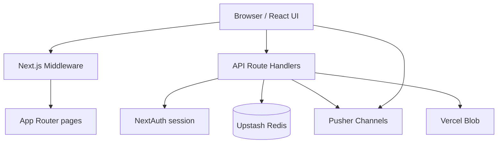

# Architecture

[Wiki home](README.md)

## High-level flow

The browser renders the Next.js application and calls route handlers. Each protected handler should authenticate the request, validate input, authorize access to the resource, persist state in Upstash Redis and publish Pusher events when clients need live synchronization.

## Repository structure

| Path | Responsibility |
| --- | --- |
| src/app | App Router pages, layouts and API handlers |
| src/app/api | Server-side HTTP endpoints |
| src/components | Feature-oriented React components |
| src/common | Shared UI primitives |
| src/helpers | Redis helpers and data access utilities |
| src/lib | Auth, Redis, Pusher, rate limiting, group logic and validation |
| src/types | Domain and library type extensions |
| tests | Regression, security and integration tests |

## Redis data

Redis stores application entities and indexes using strings, sets, sorted sets and pipelines. Key examples include user:<userId>, user:email:<email>, user:<userId>:friends, group:<groupId>, group:<groupId>:members, chat:<chatId>:messages, community:<communityId>, user:<userId>:communities and user:<userId>:community-invites. These are implementation details, not a stable public database contract; check route handlers before changing key formats.

## Mutation lifecycle

1. Parse and validate the request.
2. Resolve the authenticated user.
3. Check participant, membership, owner or admin permissions.
4. Apply rate limits where configured.
5. Persist state in Redis.
6. Publish Pusher events when needed.
7. Return a bounded response.

Persistence must remain authoritative. Group activity mutations use an atomic Redis Lua update so the feature record and corresponding inbox message are committed together.

## Pagination and contributor rules

Message history accepts a cursor and a bounded limit (1–50, default 30). Use the returned cursor metadata; do not load unbounded history. Keep Redis as durable state, authorize by resource membership, validate all untrusted input, and use atomic operations for multi-key invariants under concurrent requests.
